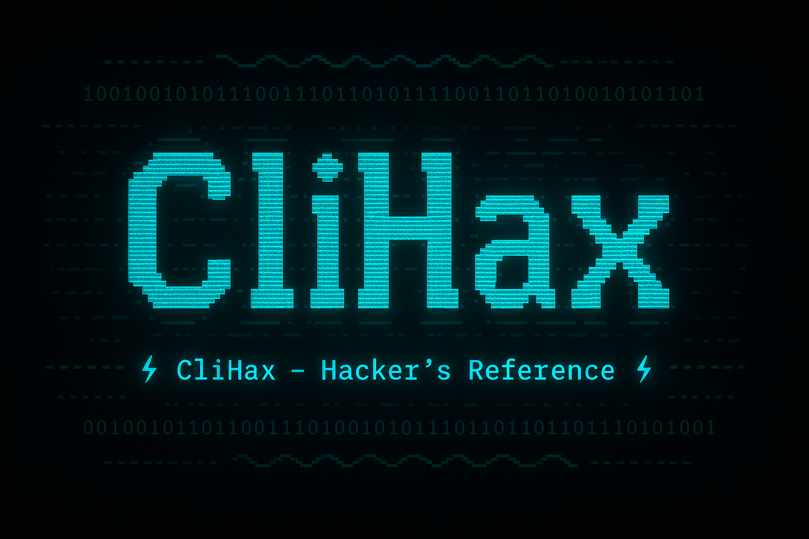
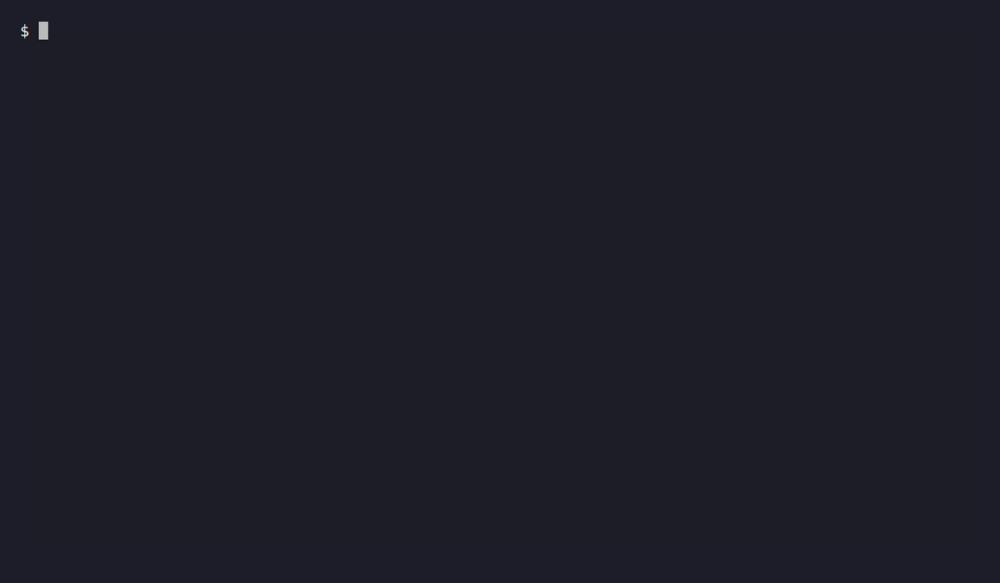
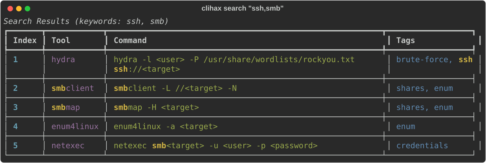
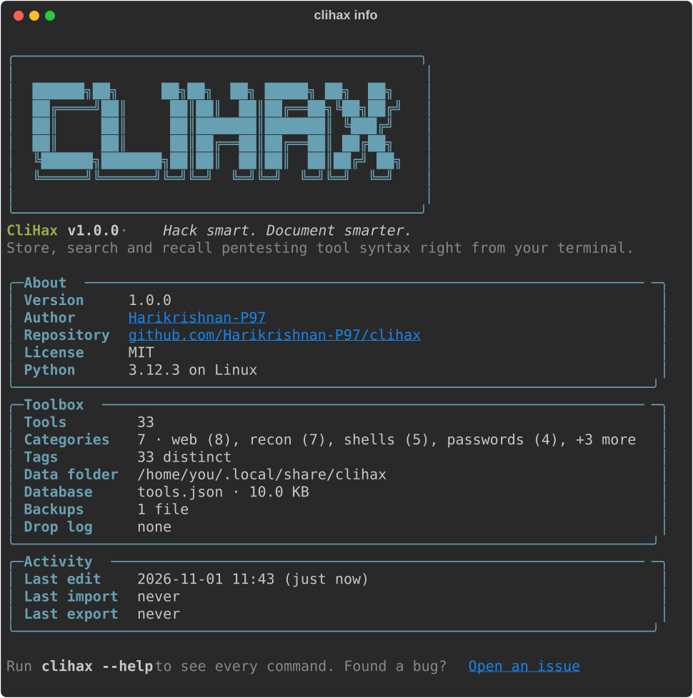

# CliHax

<p align="center">
  
</p>

<p align="center">
  A command-line reference manager for penetration testers.<br>
  Store, search and recall the commands you rely on, without leaving the terminal.
</p>

<p align="center">
  <a href="https://github.com/Harikrishnan-P97/clihax/actions"></a>
  <a href="https://www.python.org/"></a>
  <a href="LICENSE"></a>
  <a href="https://github.com/Harikrishnan-P97/clihax/commits"></a>
</p>

<p align="center">
  
</p>

## Table of contents

- [Overview](#overview)
- [Features](#features)
- [Screenshots](#screenshots)
- [Installation](#installation)
- [Getting started](#getting-started)
- [Command reference](#command-reference)
- [Searching](#searching)
- [Scripting and automation](#scripting-and-automation)
- [Shell completion](#shell-completion)
- [Data and configuration](#data-and-configuration)
- [Starter pack](#starter-pack)
- [Architecture](#architecture)
- [Development](#development)
- [Troubleshooting](#troubleshooting)
- [Contributing](#contributing)
- [License](#license)

## Overview

During an assessment or a CTF you reuse the same tools again and again, and the exact flags are easy to forget. CliHax is a small, dependable command-line application that keeps your own **searchable reference of commands** next to the work. Each entry has a tool name, the command, a description, a category and tags. Any command can be copied to the clipboard in one step.

CliHax stores and recalls command text only. It does not run commands, scan targets or contain exploit code.

| | |
|---|---|
| Language | Python 3.10 or newer |
| Libraries | [Click](https://click.palletsprojects.com/) (CLI), [Rich](https://github.com/Textualize/rich) (terminal output), [pyperclip](https://github.com/asweigart/pyperclip) (clipboard), [platformdirs](https://github.com/tox-dev/platformdirs) (data location) |
| Packaging | Poetry, PEP 621 metadata, installable with pipx |
| Quality | More than 200 pytest tests, ruff linting, GitHub Actions CI on Python 3.10 to 3.14 |
| Platforms | Developed and tested on Linux. Data locations follow the conventions of macOS and Windows. |

## Features

**Managing commands**
- Add, edit, delete, list and show entries with a name, command, description, category and tags.
- Import and export JSON; imports are validated and duplicates are skipped.
- A built-in [starter pack](#starter-pack) of 33 common commands.

**Finding commands**
- Keyword search across name, command, description and tags; filter by tag and category.
- Matches are highlighted. If nothing matches exactly, close matches are offered (`nmpa` finds `nmap`).
- Copy a result straight to the clipboard with `--copy`.

**Automation**
- `--json` output on `list`, `show`, `search` and `searchfilter`, with a clean stdout/stderr split.
- Plain output when piped; `--no-color` and the `NO_COLOR` variable are honoured.
- Documented exit codes and Tab completion for bash, zsh and fish.

**Data safety**
- Data lives in a per-user folder and works from any directory.
- Writes are atomic (temporary file, then rename), so a crash cannot corrupt the database.
- `drop` asks for confirmation, offers a backup and records an audit log.

## Screenshots

<p align="center">
  
</p>

<p align="center">
  
</p>

More screenshots, with captions, are in the [screenshot gallery](docs/screenshots.md).

## Installation

Requirements: **Python 3.10 or newer**. On Linux, copying to the clipboard needs `xclip` or `wl-clipboard` (`sudo apt install xclip`).

### With pipx (recommended)

[pipx](https://pipx.pypa.io/) installs the command in its own isolated environment and puts `clihax` on your `PATH`.

```bash
pipx install git+https://github.com/Harikrishnan-P97/clihax.git
clihax --version
```

Upgrade with `pipx upgrade clihax` and remove with `pipx uninstall clihax`.

### From source with Poetry

```bash
git clone https://github.com/Harikrishnan-P97/clihax.git
cd clihax
poetry install
poetry run clihax --help
```

The package can also be run as a module: `poetry run python -m clihax --help`.

## Getting started

A first session, step by step. Every command is explained in the [command reference](#command-reference).

**1. Load the starter pack.** Preview it first, then add it:

```bash
clihax starter --list
clihax starter
```

**2. Look around.**

```bash
clihax list --quick
```

```text
[1] nmap: nmap -sC -sV -oA scan <target> (recon)  # nmap, scan
[2] nmap: nmap -p- --min-rate 5000 -T4 <target> (recon)  # nmap, scan, ports
[3] nmap: nmap -sU --top-ports 100 <target> (recon)  # nmap, udp
...
```

The number in brackets is the entry's index, used by `show`, `edit` and `delete`.

**3. Search.**

```bash
clihax search smb --quick
```

```text
[1] smbclient: smbclient -L //<target> -N  # List SMB shares without a password
[2] smbmap: smbmap -H <target>  # Show SMB shares and permissions
[3] enum4linux: enum4linux -a <target>  # Full SMB/Windows enumeration
[4] netexec: netexec smb <target> -u <user> -p <password>  # Check SMB credentials
```

**4. Use a command.** Show an entry and copy its command to the clipboard, then paste it and replace the placeholders such as `<target>`:

```bash
clihax show 1 --copy
```

**5. Add your own command.** `add` asks for each field:

```text
$ clihax add
Enter tool name: feroxbuster
Enter command: feroxbuster -u http://<target> -w <wordlist>
Enter description: Recursive content discovery
Category (e.g., recon, scan, attack, post): web
Tags (comma-separated, optional): directories, fuzzing
✅ Added 'feroxbuster' command successfully!
```

**6. Keep a copy.**

```bash
clihax export mytools.json      # write all tools to a JSON file
clihax import mytools.json      # merge a JSON file into your tools
```

## Command reference

```text
clihax [--no-color] [--version] [--help] COMMAND [ARGS]...
```

| Global option | Description |
|---------------|-------------|
| `-v`, `--version` | Show the version and exit. |
| `--no-color` | Disable coloured output. Put it before the command: `clihax --no-color list`. |
| `--help` | Show help. Every command also accepts `--help`. |

| Command | Purpose |
|---------|---------|
| [`add`](#add) | Add a tool interactively. |
| [`list`](#list) | List all tools. |
| [`show`](#show) | Show one tool in full. |
| [`edit`](#edit) | Edit a tool interactively. |
| [`delete`](#delete) | Delete a tool. |
| [`search`](#search) | Search by keyword. |
| [`searchfilter`](#searchfilter) | Filter by tag, category and keywords. |
| [`starter`](#starter) | Add the built-in starter pack. |
| [`import`](#import) | Merge tools from a JSON file. |
| [`export`](#export) | Write all tools to a JSON file. |
| [`drop`](#drop) | Delete all tools, with backup and log. |
| [`logs`](#logs) | View or clear the drop history. |
| [`info`](#info) | About, statistics and recent activity. |
| [`completion`](#completion) | Print the Tab-completion script. |

Indexes are 1-based and refer to the position shown by `list`. They change when a tool before them is deleted.

### add

```text
clihax add
```

Prompts for the tool name, command, description, category and tags (comma-separated, optional), then stores the entry with creation and update timestamps.

### list

```text
clihax list [-q | --quick] [-a | --all] [-p | --pager] [--json]
```

| Option | Description |
|--------|-------------|
| `-q`, `--quick` | Plain lines instead of a table. |
| `-a`, `--all` | Include description and timestamps. |
| `-p`, `--pager` | Show the table in a scrollable pager (press `q` to quit). |
| `--json` | Print all tools as JSON. Cannot be combined with `--quick` or `--pager`. |

### show

```text
clihax show INDEX [-C | --copy] [--json]
```

Shows every field of one tool. `--copy` copies the command to the clipboard first. With `--json` an invalid index prints an error on stderr and exits with status 1.

```text
$ clihax show 1
                          Details for Tool [1]: nmap
┏━━━━━━━━━━━━━━┳━━━━━━━━━━━━━━━━━━━━━━━━━━━━━━━━━━━━━━━━━━━━━━━━━━━━━━━━━━━━━┓
┃ Field        ┃ Value                                                       ┃
┡━━━━━━━━━━━━━━╇━━━━━━━━━━━━━━━━━━━━━━━━━━━━━━━━━━━━━━━━━━━━━━━━━━━━━━━━━━━━━┩
│ Tool         │ nmap                                                        │
│ Command      │ nmap -sC -sV -oA scan <target>                              │
│ Description  │ Default scripts and version detection, saved in all formats │
│ Category     │ recon                                                       │
│ Tags         │ nmap, scan                                                  │
│ Created At   │ 2026-11-01T11:38:21                                         │
│ Last Updated │ 2026-11-01T11:38:21                                         │
└──────────────┴─────────────────────────────────────────────────────────────┘
```

### edit

```text
clihax edit INDEX
```

Prompts for each field with the current value as the default. Press Enter to keep a value. The creation time is preserved and the update time is refreshed.

### delete

```text
clihax delete INDEX
```

Removes one tool **immediately, without asking for confirmation**. Later tools move up by one index. Use [`export`](#export) first if you may want it back.

### search

```text
clihax search KEYWORDS [-q | --quick] [-C N | --copy N] [--json]
```

`KEYWORDS` is one argument; separate several keywords with commas (any of them may match). See [Searching](#searching) for the exact rules.

| Option | Description |
|--------|-------------|
| `-q`, `--quick` | Plain lines instead of a table. |
| `-C N`, `--copy N` | Copy the command of result number `N` (as displayed) and exit. |
| `--json` | Print the matches as JSON. Cannot be combined with `--quick` or `--copy`. |

```bash
clihax search nmap
clihax search "ftp,ssh" --quick
clihax search "reverse shell" --copy 1
```

### searchfilter

```text
clihax searchfilter [-t TAG] [-c CATEGORY] [KEYWORDS] [-q] [-C N] [--json]
```

Combines a tag, a category and keywords. Every condition you give must hold. Options match those of `search`, plus:

| Option | Description |
|--------|-------------|
| `-t TAG`, `--tag TAG` | Keep tools that have this tag. |
| `-c CATEGORY`, `--category CATEGORY` | Keep tools in this category. |

```bash
clihax searchfilter -c web -t fuzzing
clihax searchfilter -c attack "ftp,ssh"
clihax searchfilter -t smb --quick
```

With no options it lists every tool.

### starter

```text
clihax starter [-l | --list] [-y | --yes]
```

Adds the [starter pack](#starter-pack). Tools you already have are never changed or duplicated.

| Option | Description |
|--------|-------------|
| `-l`, `--list` | Only show what would be added. |
| `-y`, `--yes` | Add without asking for confirmation. |

### import

```text
clihax import FILENAME
```

Merges a JSON file (a list of tool objects) into your tools. Each entry needs a `tool` and a `command`; other fields get defaults. Entries missing those two fields are skipped and counted, and an entry with the same tool and command as an existing one is a duplicate and is skipped. Tags may be a list or a comma-separated string. See [Data and configuration](#data-and-configuration).

### export

```text
clihax export [FILENAME]
```

Writes all tools to `FILENAME` (default `exported_tools.json` in the current folder). Duplicate entries are written once.

### drop

```text
clihax drop [-f | --force]
```

Deletes **all** tools. It asks for confirmation, offers to save a backup (the default answer is yes), and records the event in the drop log. If the backup fails it asks before continuing without one. With `--force` it skips the prompts and the backup (the log entry is still written).

```text
$ clihax drop
⚠️  WARNING: You are about to delete ALL stored tools permanently.
This action CANNOT be undone.

Are you sure you want to continue? [y/N]: y
Do you want to back up your tools before dropping them? [Y/n]: y
Backup saved to: ~/.local/share/clihax/backups/tools_backup_2026-11-01T11-38-22.json
All tools dropped successfully.
Drop event logged successfully.
```

### logs

```text
clihax logs [--clear]
```

Shows the drop history (time, number of tools dropped, whether it was forced, whether a backup was made). `--clear` empties the log.

### info

```text
clihax info [-q | --quick]
```

Shows the version, author, repository, Python version, the number of tools, categories and tags, the data folder, database size, number of backups, and the time of the last edit, import and export. `--quick` prints plain text without the banner.

### completion

```text
clihax completion {bash|zsh|fish}
```

Prints the Tab-completion script for the chosen shell. See [Shell completion](#shell-completion).

## Searching

| Condition | Rule |
|-----------|------|
| Keyword | Case-insensitive substring of the tool name, command or description, **or** an exact match of one of the tags. |
| Several keywords | Separated by commas; a tool matches if **any** keyword matches. |
| `--tag` | Exact match of one of the tool's tags (case-insensitive). |
| `--category` | Exact match of the category (case-insensitive). |
| Combined options | A tool must satisfy **all** the options given. |

**Close matches.** If a keyword search finds nothing, CliHax tries again and lists tools containing words that are very similar to the keyword (at least 75% similar, keywords of three or more characters). A notice is printed on stderr, for example:

```text
$ clihax search nmpa --quick
ℹ️  No exact match for 'nmpa'. Showing close matches.
[1] nmap: nmap -sC -sV -oA scan <target>  # Default scripts and version detection, saved in all formats
```

Exact and close matches are never mixed, and tag and category filters always stay exact.

## Scripting and automation

`list`, `show`, `search` and `searchfilter` accept `--json`. In `--json` mode only JSON is written to stdout; notices and errors go to stderr.

```bash
clihax search nmap --json | jq -r '.[].command'
clihax searchfilter -c recon --json | jq 'length'
clihax show 2 --json
```

Each tool is an object with its displayed `index` followed by the stored fields:

```json
{
  "index": 1,
  "tool": "nmap",
  "command": "nmap -sC -sV -oA scan <target>",
  "description": "Default scripts and version detection, saved in all formats",
  "tags": ["nmap", "scan"],
  "category": "recon",
  "created_at": "2026-11-01T11:38:21",
  "updated_at": "2026-11-01T11:38:21"
}
```

`list`, `search` and `searchfilter` print a JSON array, which is `[]` when nothing matches. `show` prints a single object.

**Colour.** Output is coloured only on a real terminal. Piped or redirected output is plain. Use `clihax --no-color ...` or set `NO_COLOR=1` to switch colours off on a terminal as well.

**Exit status**

| Code | Meaning |
|------|---------|
| 0 | Success. Interactive commands report conditions such as "no matches" as a message and still exit 0. |
| 1 | Runtime error, for example an unreadable `tools.json`, `show --json` with an invalid index, or a cancelled prompt. |
| 2 | Usage error, for example an unknown option or `--json` combined with `--quick`. |

## Shell completion

Tab completes commands and options, and also values from your own data: tags (`-t`), categories (`-c`) and tool numbers for `show`, `edit` and `delete`. Add one line to your shell's startup file and open a new terminal:

```bash
# bash
echo 'eval "$(clihax completion bash)"' >> ~/.bashrc

# zsh
echo 'eval "$(clihax completion zsh)"' >> ~/.zshrc

# fish
clihax completion fish > ~/.config/fish/completions/clihax.fish
```

## Data and configuration

CliHax keeps its files in a per-user data folder, so it works from any directory. `clihax info` shows the active path.

| OS | Default location |
|----|------------------|
| Linux | `~/.local/share/clihax/` |
| macOS | `~/Library/Application Support/clihax/` |
| Windows | `%LOCALAPPDATA%\clihax\` |

```text
<data folder>/
├── tools.json         your tools
├── meta.json          times of the last edit, import and export
├── backups/           tools_backup_<timestamp>.json, written by `drop`
└── logs/drops.json    drop history
```

| Environment variable | Effect |
|----------------------|--------|
| `CLIHAX_HOME` | Use this folder instead of the default, for example inside a synced directory. |
| `NO_COLOR` | When set to a non-empty value, disable coloured output. |

**Tool entries.** `tools.json` is a JSON array of objects with these fields (see also [docs/tool-format.md](docs/tool-format.md)):

| Field | Type | Description |
|-------|------|-------------|
| `tool` | string | Tool name, for example `nmap`. Required. |
| `command` | string | The command, with placeholders such as `<target>`. Required. |
| `description` | string | Short note. |
| `category` | string | For example `recon`, `web`, `passwords`, `post`. |
| `tags` | array of strings | Used by search and `--tag`. |
| `created_at`, `updated_at` | string | ISO 8601 timestamps, set automatically. |

The smallest file that `import` accepts:

```json
[
  { "tool": "ls", "command": "ls -la" }
]
```

**Upgrading from v1.0.** Version 1.0 kept data in a `data/` folder next to where you ran it. If you run `clihax` in a folder that still contains `data/tools.json` and have no database yet, the files are copied to the new location once, without overwriting anything.

## Starter pack

`clihax starter` adds these 33 commands. Placeholders such as `<target>`, `<domain>`, `<lhost>` and `<lport>` are meant to be replaced after pasting.

| Category | Tools | Count |
|----------|-------|-------|
| `recon` | nmap, masscan, subfinder, amass, dnsrecon | 7 |
| `web` | gobuster, ffuf, nikto, whatweb, wpscan, sqlmap | 8 |
| `passwords` | hydra, hashcat, john | 4 |
| `smb` | smbclient, smbmap, enum4linux, netexec | 4 |
| `shells` | netcat, bash, msfvenom, python3 | 5 |
| `privesc` | sudo, find, linpeas | 3 |
| `transfer` | python3 http.server, wget | 2 |

## Architecture

```text
clihax/
├── clihax/
│   ├── __init__.py       version (read from package metadata), author, licence, repository
│   ├── __main__.py       python -m clihax
│   ├── cli.py            top-level group, global options, command registration
│   ├── ui.py             presentation: tables, banner, highlighting, JSON and colour handling
│   ├── starter.py        the built-in starter pack
│   ├── commands/
│   │   ├── tools.py      add, list, show, edit, delete
│   │   ├── search.py     search, searchfilter
│   │   ├── data.py       import, export, drop, logs
│   │   ├── starter.py    starter
│   │   ├── info.py       info
│   │   └── completion.py completion command and Tab-completion helpers
│   └── utils/
│       ├── helpers.py    storage: data folder, atomic JSON writes, backups, migration, validation
│       ├── search.py     pure search and filter logic
│       └── stats.py      pure statistics and formatting helpers
├── tests/                pytest suite
├── docs/                 tips and tricks, data format, troubleshooting
├── scripts/              make_screenshots.py and demo.tape regenerate the README media
├── assets/               banner, screenshots and demo GIF
└── .github/workflows/    CI
```

Design decisions:

- **Commands decide what to show; `ui.py` decides how it looks; `utils/` never prints.** Search and statistics are plain functions, which keeps them easy to test.
- **Atomic writes.** Files are written to a temporary file and renamed into place.
- **Destructive actions are guarded.** `drop` needs confirmation, offers a backup and writes an audit log. A corrupt database produces a one-line error naming the file instead of a traceback.
- **Stored text is shown literally.** Commands containing characters such as `[port]` are not interpreted as terminal markup.
- **Machine-readable output stays clean.** In `--json` mode only JSON goes to stdout; notices and errors go to stderr, so the output can be piped safely.
- **One source of truth for the version.** It lives in `pyproject.toml` and is read at runtime from the package metadata.

## Development

```bash
git clone https://github.com/Harikrishnan-P97/clihax.git
cd clihax
poetry install
poetry run pytest -q           # run the tests
poetry run ruff check .        # lint
```

Tests use a temporary data folder through `CLIHAX_HOME`, so they never touch your real tools. The same variable is handy for experiments: `CLIHAX_HOME=/tmp/dev poetry run clihax starter --yes`.

GitHub Actions runs the tests and the linter on Python 3.10, 3.11, 3.12, 3.13 and 3.14 for every push and pull request. To regenerate the README screenshots from real output, run `poetry run python scripts/make_screenshots.py`. The demo GIF is recorded with [VHS](https://github.com/charmbracelet/vhs) from `scripts/demo.tape`: `poetry run vhs scripts/demo.tape`.

The project follows [Semantic Versioning](https://semver.org/); changes are listed in the [changelog](CHANGELOG.md).

## Troubleshooting

| Problem | Solution |
|---------|----------|
| `clihax: command not found` after installing with pipx | Run `pipx ensurepath` and open a new terminal. From a source checkout use `poetry run clihax`. |
| "Clipboard unavailable" on Linux | Install a clipboard tool: `sudo apt install xclip` (X11) or `wl-clipboard` (Wayland). |
| "Could not read ... tools.json" | The file is not valid JSON. Fix it, delete it to start fresh, or restore a copy from `backups/`. |
| Tab completion does nothing | Check that the `eval` line is in your shell's startup file and open a new terminal. |
| Unexpected colour codes in a file | Colours are disabled when output is piped or redirected; otherwise use `--no-color`. |

More help is in [docs/troubleshooting.md](docs/troubleshooting.md). Please report anything else as an [issue](https://github.com/Harikrishnan-P97/clihax/issues).

## Contributing

Contributions are welcome. Please read [CONTRIBUTING.md](CONTRIBUTING.md) for the setup, the code layout and the checks a pull request must pass.

## License

CliHax is released under the [MIT License](LICENSE).

Author: [Harikrishnan-P97](https://github.com/Harikrishnan-P97)

Use the tools this reference reminds you of only on systems you own or have written permission to test.
