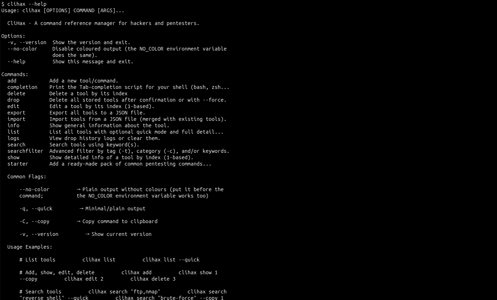
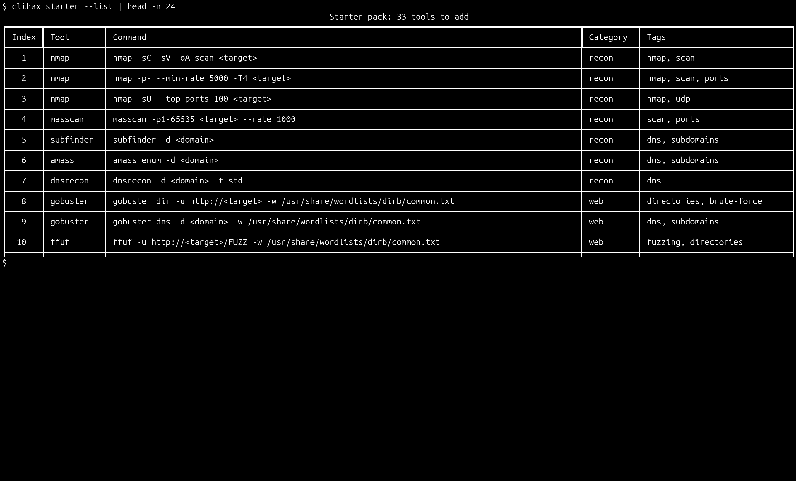
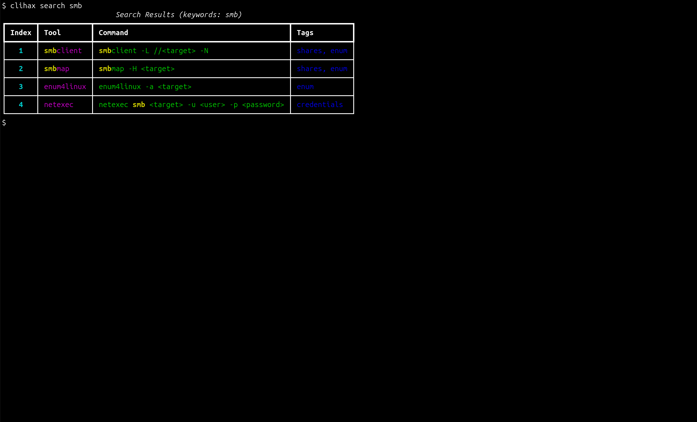
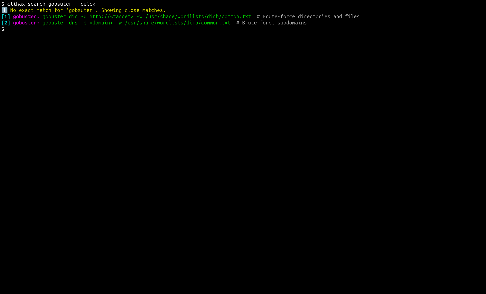
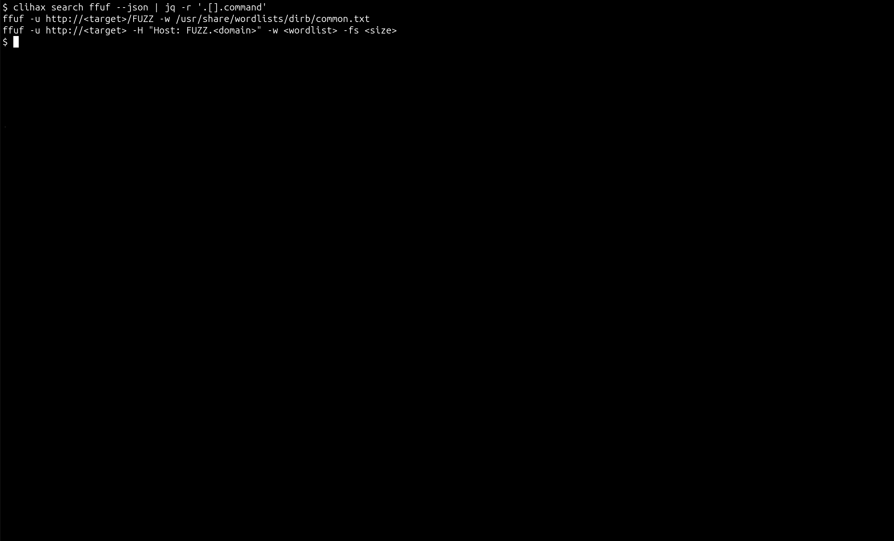
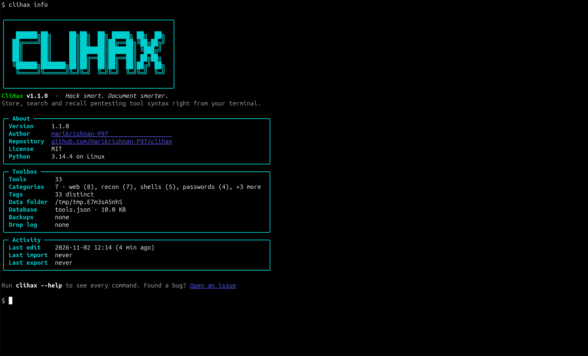
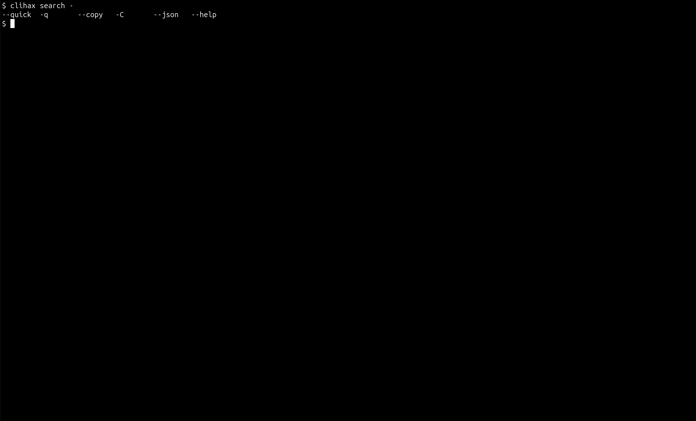
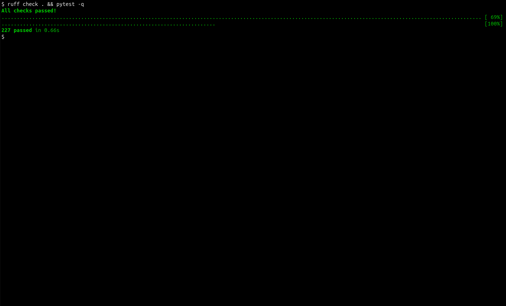
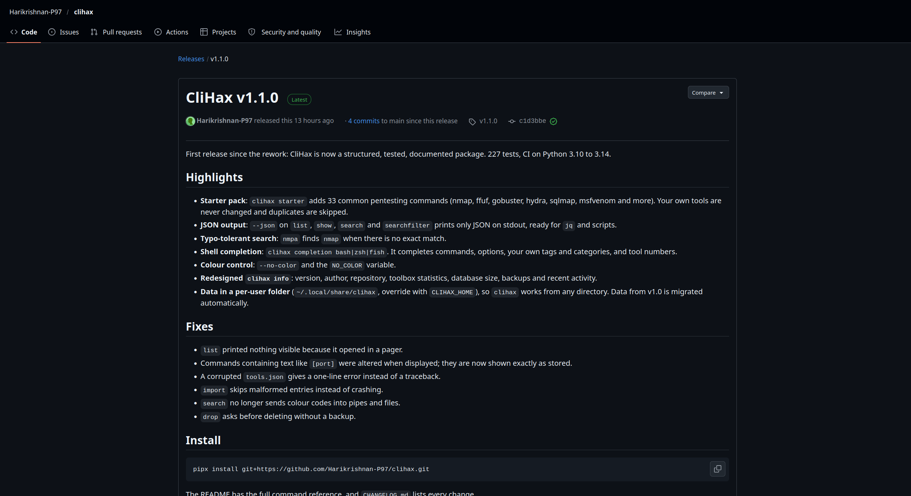

# Screenshots

Screenshots 1 to 8 were captured on Linux from CliHax v1.1.0, using a temporary toolbox loaded from the built-in starter pack. The [README](../README.md) has the full command reference.

## Overview

All commands at a glance, with usage examples in the help text.

## Starter pack

A built-in set of 33 common pentesting commands, so the tool is useful from the first run.

## Search

Keyword search across name, command, description and tags, with matches highlighted.

## Typo-tolerant search

A mistyped query (`gobsuter`) still finds `gobuster`, and says that the match is approximate.

## Scripting

Results as clean JSON on stdout, ready to pipe into other tools.

## Info dashboard

Version, author, toolbox statistics, data location and recent activity in one view.

## Shell completion

Tab completion offers the user's own tags, categories and tool numbers, not just command names.

## Quality gates

Linting passes and all tests pass.

## Release

Versioned release v1.1.0 with release notes, built from a maintained changelog.
